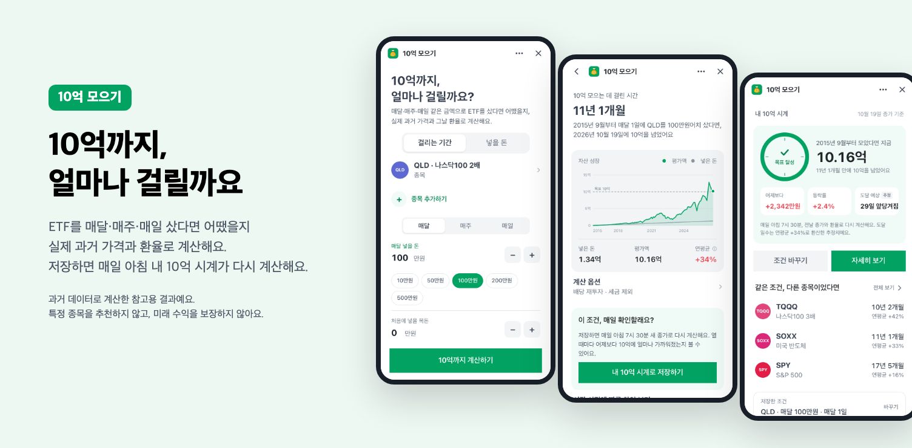
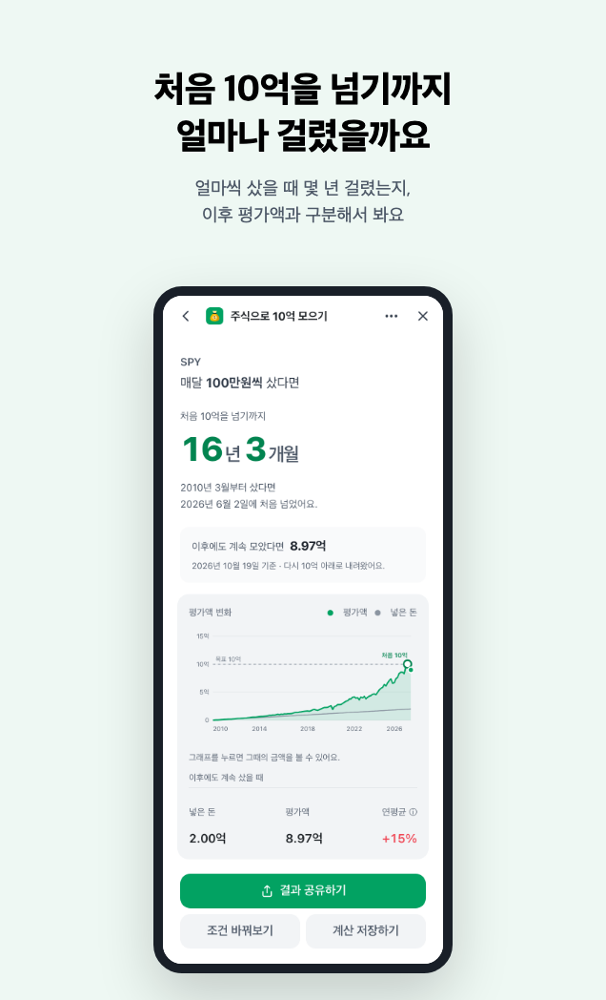
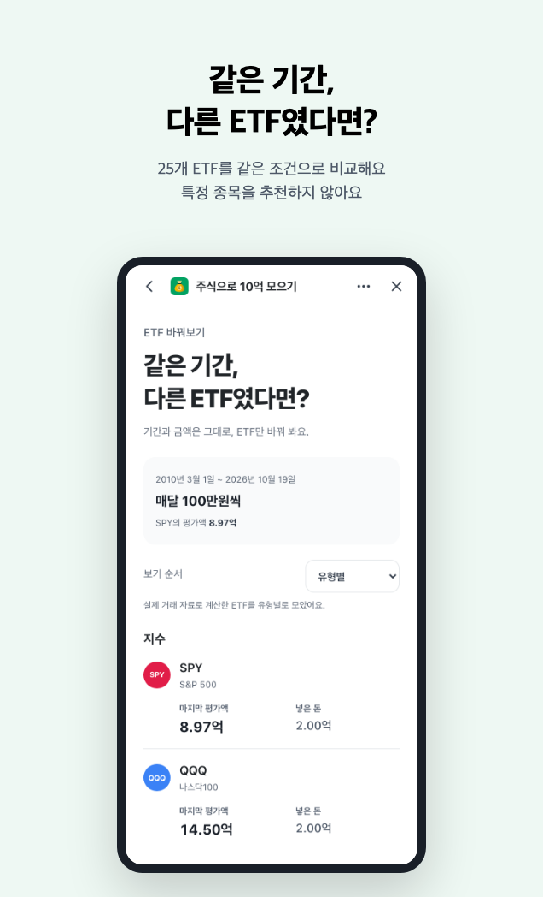
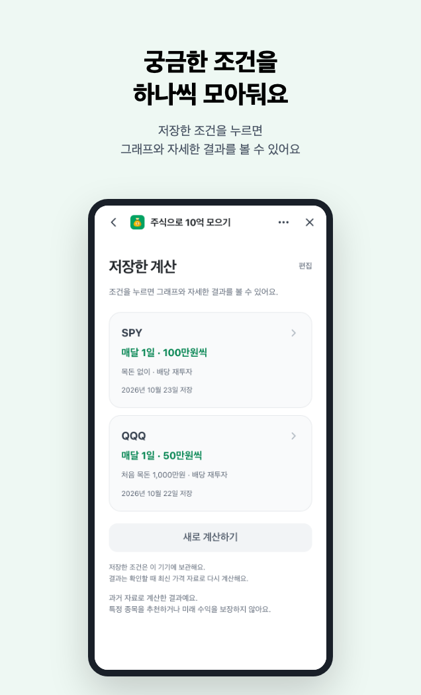
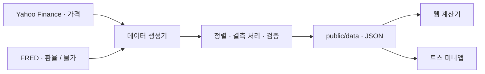

<div align="center">
  
  <h1>10-eok</h1>
  <p><strong>월급날마다 ETF를 모았다면,<br />10억까지 얼마나 걸렸을까요?</strong></p>
  <p>과거 가격과 환율로 돌아보는 ETF 적립 계산기</p>
  <p>
    <a href="https://jeongcheol.cloud">지금 계산해 보기</a> ·
    <a href="https://jeongcheol.cloud/guides">투자 가이드</a> ·
    <a href="https://jeongcheol.cloud/how-it-works">계산 방법</a>
  </p>
  <p>
    <a href="https://jeongcheol.cloud">한국어</a> ·
    <a href="https://jeongcheol.cloud/en">English</a> ·
    <a href="https://jeongcheol.cloud/ja">日本語</a> ·
    <a href="https://jeongcheol.cloud/de">Deutsch</a>
  </p>
</div>

<p align="center">
  
  <br />
  <sub>토스 미니앱 미리보기 · 웹에서도 같은 계산 흐름을 제공해요.</sub>
</p>

## 내 조건으로 돌아보는 투자

매달 50만원씩, 매주 10만원씩, 혹은 처음에 목돈을 함께 넣었다면 어땠을까요?

10-eok은 고정 수익률을 넣어 미래를 예측하는 대신, **실제로 지나온 가격과 환율에 내 조건을 대입**해요. 처음 목표를 넘은 날과 그 뒤에도 계속 모았을 때의 평가액을 나눠 보여주고, 같은 기간에 다른 ETF를 샀을 때와 비교할 수 있어요.

| 기능 | 확인할 수 있는 것 |
| --- | --- |
| **내 조건으로 계산** | ETF를 최대 5개 고르고, 종목별 적립액·매달/매주/거래일마다의 주기·처음 넣을 목돈을 설정해요. |
| **처음 목표를 넘은 시점** | 처음 목표에 도달하기까지의 기간과 날짜를 보여줘요. 이후 평가액이 다시 내려온 경우도 구분해요. |
| **평가액 변화** | 차트에서 넣은 돈과 평가액을 함께 살펴봐요. |
| **같은 기간 ETF 비교** | 계산 기간과 납입 조건을 고정하고 ETF만 바꿔 봐요. 추정 자료가 포함되면 별도로 표시해요. |
| **계산 저장·공유** | 조건별로 저장한 계산을 다시 열거나, 결과와 조건을 링크로 공유해요. |
| **ETF 설명·가이드** | 상품별 구조와 위험, 적립·복리·환율 등 결과를 읽는 데 필요한 설명을 제공해요. |

<details>
  <summary><strong>결과·비교·저장 화면 보기</strong></summary>
  <br />
  <table>
    <tr>
      <td align="center"><strong>계산 결과</strong></td>
      <td align="center"><strong>같은 기간 ETF 비교</strong></td>
      <td align="center"><strong>저장한 계산</strong></td>
    </tr>
    <tr>
      <td></td>
      <td></td>
      <td></td>
    </tr>
  </table>
  <p><sub>토스 미니앱 화면이에요. 표시된 수치는 각 화면의 조건과 데이터 기준일에 따른 과거 계산 결과예요.</sub></p>
</details>

## 웹과 토스 미니앱

하나의 저장소에서 두 앱을 개발해요. 가격·환율을 합치는 로직과 기본 계산 엔진을 공유하고, UI와 플랫폼 연동은 분리했어요.

| | 웹 | 토스 미니앱 |
| --- | --- | --- |
| 화면 | Next.js · React | Vite · React · Toss Design System |
| 언어·통화 | 한국어/KRW · English/USD · 日本語/JPY · Deutsch/EUR | 한국어/KRW |
| 종목 | 한국어 16종 · 다른 언어 15종 | 미국·국내 상장 ETF 25종 |
| 실행 | 브라우저 | Apps in Toss WebView · 브라우저 미리보기 |
| 광고 연동 | Google AdSense | Apps in Toss 광고 SDK |
| 배포 산출물 | Next.js 앱 | `toss/10-eok.ait` |

저장한 계산은 **현재 기기와 브라우저의 로컬 저장소**에 보관해요. 계정 간 동기화는 제공하지 않으며, 다시 열면 불러온 데이터로 재계산하므로 과거에 본 수치와 달라질 수 있어요.

## 결과를 읽는 기준

- **첫 도달 기간:** 목표를 한 번이라도 넘은 경우 중 가장 최근에 시작한 달을 찾고, 그 시작월부터 처음 목표를 넘은 날까지 계산해요. 모든 시작월 중 가장 짧은 기간을 뜻하지는 않아요.
- **이후 평가액:** 첫 도달 뒤에도 계속 샀을 때, 자료의 마지막 날 기준 평가액이에요. 한 번 목표를 넘었어도 다시 내려올 수 있어요.
- **실제 자료와 추정:** 기본 계산에는 실제 거래 이력을 사용해요. ETF 비교에서만 다른 ETF·지수로 보완한 추정 구간을 허용하고, 사용 자료와 한계를 표시해요. 기간을 채울 자료가 없으면 비교 금액을 표시하지 않아요.
- **매수·배당:** 휴장일에 예정된 매수는 다음 거래일로 옮겨요. 소수점 매수를 가정하고, 배당 재투자는 수정주가로 반영해요. 투자자의 거래 수수료·스프레드는 제외해요.
- **연평균:** 자산 가격의 증가율을 연 단위 복리로 환산한 값이에요. 매수 시점별 납입금을 반영한 투자자 수익률과는 달라요.

과거 자료로 계산한 참고용 결과예요. 특정 종목을 추천하거나 미래 수익을 보장하지 않아요. 세금·물가 옵션 등 세부 가정은 [계산 방법](https://jeongcheol.cloud/how-it-works)에서 확인할 수 있어요.

## 데이터는 이렇게 들어와요

사용자가 계산할 때마다 외부 금융 API에 요청하지 않아요. 미리 생성한 JSON을 불러와 **입력 조건에 따른 시뮬레이션을 브라우저·기기에서 실행**해요.



[GitHub Actions](.github/workflows/refresh-data.yml)가 매일 **22:30 UTC / 다음 날 07:30 KST**에 데이터 갱신을 시도해요. 변경된 번들을 커밋하면 Vercel Git 연동으로 웹과 공개 데이터가 배포돼요. 시장 휴장일이나 원자료 제공 지연에 따라 실제 데이터 기준일은 달라질 수 있어요.

| 자료 | 출처 | 저장 위치 |
| --- | --- | --- |
| 종목별 가격·수정주가 | Yahoo Finance | `public/data/px/` |
| 원·엔·유로의 달러 환율 | FRED: `DEXKOUS` · `DEXJPUS` · `DEXUSEU` | `public/data/fx/` |
| 지원 시장의 소비자물가지수 | FRED의 한국·미국 CPI 및 Eurostat 유로존 지수 | `public/data/cpi/` |
| 사전 계산 요약 | 데이터 생성기 | `public/data/summary/` |

사전 계산 요약과 화면의 첫 도달 계산은 목적이 달라요. 웹 ETF 상세의 예시는 웹 계산기와 같은 계산 함수를 사용해요.

## 로컬에서 실행하기

**Node.js 24 · pnpm 10 이상**을 사용해요. 저장소에 데이터 번들이 포함돼 있어, 화면을 실행하기 전에 데이터를 새로 수집할 필요는 없어요.

```bash
git clone https://github.com/JeongCheolLee/10-eok.git
cd 10-eok
pnpm install

# 웹 · http://localhost:3000
pnpm dev
```

별도 터미널에서 토스 미니앱을 미리 볼 수 있어요.

```bash
# 미니앱 · http://localhost:5173
# 브라우저 미리보기에서는 공개 JSON 데이터 주소를 지정해요.
VITE_DATA_BASE=https://jeongcheol.cloud/data pnpm --dir toss dev
```

토스 공유·광고 등 플랫폼 기능은 브라우저 미리보기와 실제 토스 앱에서 동작이 다를 수 있어요. 실제 연동은 토스 앱의 테스트 환경에서 확인해야 해요.

<details>
  <summary><strong>미니앱 빌드 설정</strong></summary>

빌드 환경에 따라 `toss/.env.production.local`에 설정해요. 로컬 환경 파일은 Git에서 제외돼요.

| 변수 | 용도 |
| --- | --- |
| `VITE_DATA_BASE` | 공개 JSON 데이터의 기본 주소 |
| `VITE_AD_BANNER_ID` | 콘솔에서 발급받은 배너 광고 지면 ID |
| `VITE_AD_REWARDED_ID` | 콘솔에서 발급받은 리워드 광고 지면 ID |
| `VITE_REWARDED_ADS_ENABLED` | `true`와 명시적 리워드 지면 ID가 함께 있을 때 리워드 기능을 활성화해요. |

리워드 기능은 기본 비활성 상태예요. 광고 지면과 사용 조건을 확인한 뒤 설정해야 해요.

</details>

## 빌드와 검증

```bash
# 단위 테스트 · 웹/미니앱 타입 검사
pnpm test
pnpm exec tsc --noEmit
pnpm exec tsc --noEmit -p toss/tsconfig.json

# 웹 브라우저 테스트 · 처음 한 번 Chromium 설치
pnpm exec playwright install chromium
pnpm e2e

# 웹 운영 빌드 / 실행
pnpm build
pnpm start

# 미니앱 WebView 번들 / 업로드용 AIT
pnpm --dir toss build
pnpm --dir toss build:ait

# 원자료를 다시 수집하고 public/data를 갱신할 때만 실행
pnpm gen
```

단위 테스트는 거래일·환율 정렬, 계산 엔진, 포트폴리오, 실제/추정 이력 분리 등을 확인해요. Playwright는 네 언어의 입력·계산·저장·비교, ETF 선택창 위치와 키보드 동작, ETF 상세 예시와 실제 결과의 일치를 검사해요.

## 코드 둘러보기

```text
app/                    Next.js 페이지 · ETF 상세 · 가이드 · OG 이미지
components/             웹 입력 · 결과 · 비교 · 저장 화면
lib/
  backtest/             가격·환율 결합, 거래 일정과 기본 계산 엔진
  web-calculator.ts     웹 조건·포트폴리오·첫 도달 계산
  tickers.ts            종목 정보와 실제/추정 자료 구분에 쓰는 설정
  i18n/                 언어·통화·시장별 설정과 문구
  content/              ETF·가이드 다국어 원고
  legal/                미니앱 약관·개인정보처리방침
generator/             데이터 수집·검증·번들 생성
public/data/            앱에서 읽는 공개 JSON 데이터
toss/
  src/                  미니앱 화면·계산 흐름·플랫폼 연동
  store/                등록용 로고·스크린샷·생성 스크립트
  apps-in-toss.config.ts 앱인토스 빌드 설정
e2e/                   Playwright 브라우저 테스트
```

기능별 동작과 화면 문구는 [계산 방법](https://jeongcheol.cloud/how-it-works), [UX 라이팅 가이드](toss/UX_WRITING.md), 종목별 설명은 [투자 가이드](https://jeongcheol.cloud/guides)를 참고해요.
